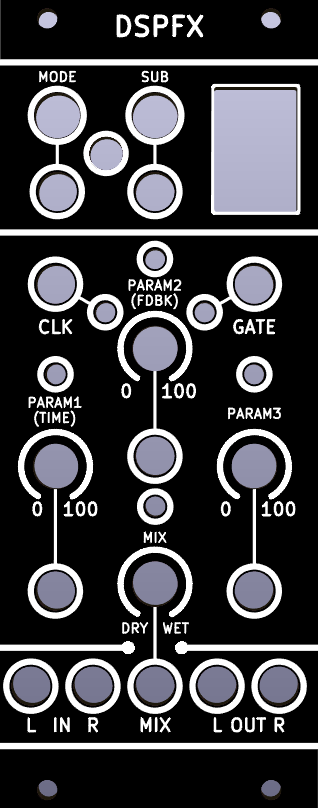

# DSP-FX32

10hp Digital Multi Effects (Work in Progress)

DSPFX is a digital multi effects module in 10hp. Featuring an ESP32-S3 microcontroller, the module can be freely programmmed with custom firmwares.

# Features

- Stereo Audio in and out
- Changing effects on the fly
- Voltage control over four parameters
- Clock and Gate inputs

# Modes

By pressing the buttons, or sending gate signals to **MODE** and **SUB**, the active digital effect can be changed on the fly.

**MODE** changes what digital effect is active, such as Delay, Reverb, Chorus, etc.

**SUB** changes the sub-mode of the module, such as changing the effect from a "Room Reverb" to "Spring Reverb".

| LED | Mode | PARAM1 | PARAM2 | PARAM3 | MIX | 
| ------------- | ------------- | ------------- | ------------- | ------------- | ------------- |
| 1a | Room Reverb | Time | Feedback Amount | NF | Wet/Dry Mix |
| 1b | Spring Reverb | Time | Feedback Amount | NF | Wet/Dry Mix |
| 2a | Tape Delay | Time | Feedback Amount | NF | Wet/Dry Mix |
| 2b | High Pass Delay | Time | Feedback Amount | NF | Wet/Dry Mix |
| 3 | Chorus | Time | Feedback Amount | NF | Wet/Dry Mix |
| 4 | Flanger | Time | Feedback Amount | NF | Wet/Dry Mix |

# CLK and GATE Input

Sending a clock signal to the **CLK** input overrides the settings of the **PARAM1** knob and CV settings. This allows for effects to be more precisely timed than it would be possible with the knob and CV settings.

The **GATE** input enables/disables a parameter for a given audio effect. 
